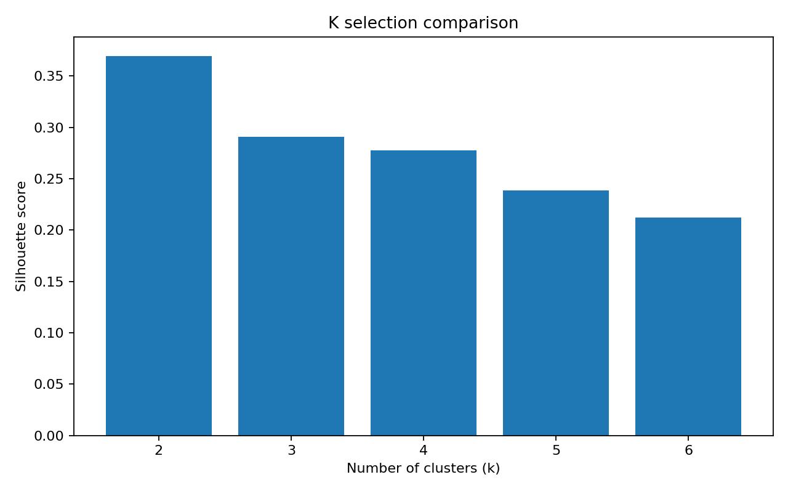
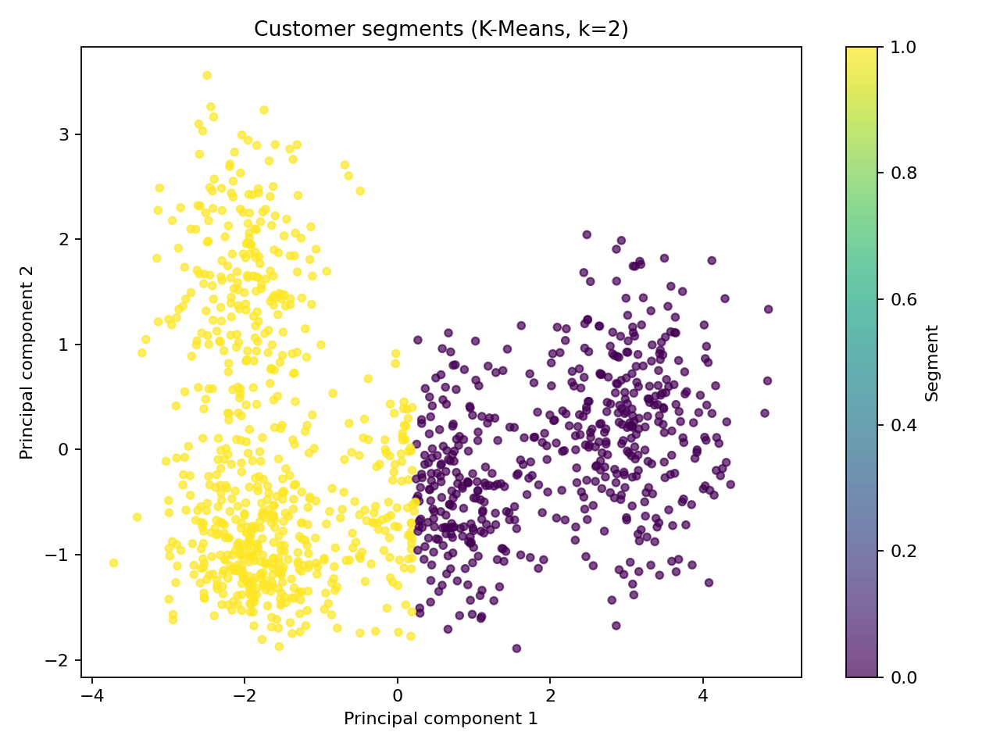
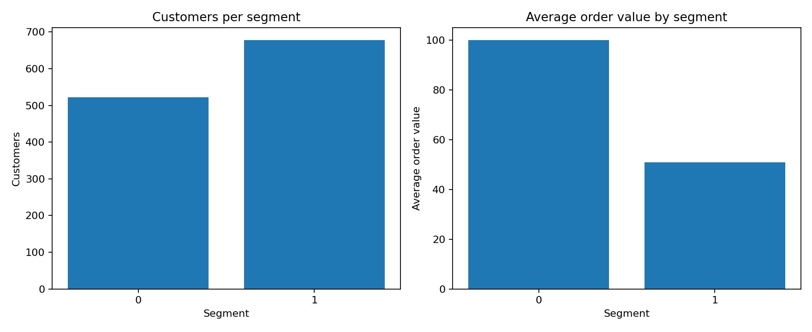

# Customer Segmentation Project — Internship Report

## 1. Executive summary
This project applies unsupervised machine learning to group customers with similar demographic and purchasing characteristics. K-Means clustering was applied to a reproducible demonstration dataset containing **1,200 synthetic customer records**. The selected model used **2 clusters**, based on the highest silhouette score among the tested values of k=2 to 6 (**0.370**).

> **Data disclosure:** The dataset is synthetically generated for learning and demonstration. It is not real Thiranex, employer, or customer data. Replace it with an authorised business dataset before making operational decisions.

## 2. Business objective
- Identify customer groups with similar purchase behaviour.
- Compare spending, order value, purchase frequency and recency across groups.
- Translate the segments into practical marketing and retention actions.

## 3. Dataset and variables
The dataset contains 1,200 rows and 12 customer attributes plus a customer identifier. Numerical clustering variables:
age, annual_income_k, spending_score, purchases_last_12m, avg_order_value, days_since_last_purchase, website_visits_monthly, discount_usage_rate.

Additional descriptive attributes include gender, city tier and membership. These are retained for interpretation and are not used as direct K-Means inputs in this version.

## 4. Methodology
1. Load the CSV with Pandas and inspect its shape, data types and missing values.
2. Select numeric behavioural and demographic variables.
3. Standardise features with `StandardScaler` so different measurement scales do not dominate distance calculations.
4. Fit K-Means models for k=2 through k=6.
5. Compare silhouette scores and select the best-scoring k.
6. Assign each customer to a segment and calculate segment-level averages.
7. Use PCA to project the standardised data into two dimensions for visual inspection.

## 5. Model selection
Silhouette scores by k:
- k=2: 0.370
- k=3: 0.291
- k=4: 0.278
- k=5: 0.238
- k=6: 0.212

The selected k is 2. A higher silhouette score generally indicates better separation and cohesion, but the final number of segments should also be judged for business usefulness and stability.



## 6. Segment profiles
- **Segment 0** (522 customers; 43.5%): average age 34.4, annual income ₹68.3k, spending score 66.3/100, 6.5 purchases in 12 months, average order value ₹100.11, and 23 days since last purchase.
- **Segment 1** (678 customers; 56.5%): average age 32.9, annual income ₹38.1k, spending score 28.3/100, 2.1 purchases in 12 months, average order value ₹50.98, and 72 days since last purchase.





Segment numbers are machine-generated labels, not rankings. Review the profile table before assigning business names such as loyal/high-value, emerging, discount-sensitive or at-risk. The exact interpretation depends on the observed averages.

## 7. Business recommendations
- **Retention:** Prioritise customers with high purchase recency (long time since last purchase) and declining frequency for win-back campaigns.
- **Loyalty:** Test exclusive benefits or early access for groups with high purchase frequency and order value.
- **Personalisation:** Tailor product recommendations to each segment's spending and browsing patterns.
- **Discount control:** Use discount offers selectively; compare incremental purchases against margin impact before expanding promotions.
- **Measurement:** Track repeat purchase rate, revenue per customer, campaign conversion and customer lifetime value by segment.

## 8. Limitations
- Synthetic data cannot establish real customer behaviour or prove commercial impact.
- K-Means assumes distance-based, roughly compact clusters and is sensitive to feature selection and scaling.
- Silhouette score alone does not determine the most commercially useful segmentation.
- The current dataset does not contain transaction-level product categories, revenue history or profit margin.

## 9. Conclusion
The workflow demonstrates an end-to-end customer segmentation process: data preparation, scaling, model selection, clustering, visualisation and business interpretation. For a real deployment, rerun the workflow on approved, anonymised customer data and validate the segments with business stakeholders.

## 10. How to run
From this project folder:
```bash
pip install -r requirements.txt
python src/customer_segmentation.py
```
Outputs are saved in the `outputs/` directory.
